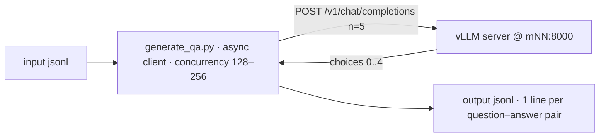

# MITOS-QA — Generation of synthetic questions and answers

This document describes the system for generating **synthetic question–answer pairs** from `data/merged_unfiltered_dataset.jsonl`. The vLLM server runs on an ARIS compute node (OpenAI-compatible API on port 8000), targeting **Bulk QA** and **128–256 parallel requests**. The goal: generation at **maximum throughput**, fully leveraging vLLM's capabilities (continuous batching, parallel sampling).

## 1. Purpose

For each line of `data/merged_unfiltered_dataset.jsonl`:

- **at least 5 unique** question–answer pairs are generated, based **exclusively** on the text of the line (title, description, requirements) — with no duplicates;
- each pair is stored as **one JSONL line** in the output file (schema §5);
- the flow never stalls: as soon as a line is completed, the next one starts immediately (see §6).

## 2. Architecture



- **vLLM server** — running on a compute node (`mNN`), OpenAI-compatible API on port 8000; for bulk generation it is started with `--dtype float32` (startup command: §6.2). The first startup takes minutes (AOT compile — longer with TP=8).
- **Client (QA generator)** — async script on the login node, where `http://<node>:8000` is directly reachable. From a PC, run `bash VLLM/TOOLS/forward_port.sh` first and then use `http://localhost:8000`.
- **Node discovery** — passed as a parameter (e.g. `--node m42`) or auto-detected from the RUNNING job (same logic as `VLLM/TOOLS/forward_port.sh`):

  ```bash
  NODE=$(squeue -u $USER -n vllm_cpu -h -t RUNNING -o "%N" | head -n 1)
  ```

- **Readiness check** before the client starts:

  ```bash
  curl -s http://$NODE:8000/v1/models
  ```

  Use the returned `id` as the `model` — this avoids a 404 caused by a different `WORKDIR`. If curl does not respond yet, the server is still loading.

## 3. Input — `data/merged_unfiltered_dataset.jsonl`

Each line has the schema:
```jsonl
{
    "source":"whatever the line has",
    "doc_id": "whatever the line has",
    "source_url": "whatever the line has",
    "title_el": "whatever the line has",
    "simple_description": "whatever the line has",
    "requirements": "whatever the line has"
}
```

The line's fields pass through **verbatim** to the output.

## 4. Generation flow

For each input line:

1. **Prompt** — build a `user` message that includes the line's title, description and requirements (§4.1).
2. **Send** — `POST /v1/chat/completions` with:
   - `n: 5` → the prompt is processed **once** and 5 independent samples are generated (parallel sampling) — faster than 5 separate requests (1 prefill instead of 5);
   - `temperature: 0.8–1.0`, `top_p: 0.95`, `max_tokens: ~1024`, `stream: false`, a fixed `seed` per (doc, sample) for reproducibility;
   - **never** `temperature = 0` with `n > 1` — all samples would be identical.
3. **Parsing** — from each `choices[i].message.content`, the strings "Ερώτηση: …" and "Απάντηση: …" ("Question: …" / "Answer: …") are extracted.
4. **Dedup** — normalization (lowercase, no accents/punctuation/double spaces) + a similarity check (e.g. `difflib.SequenceMatcher(...).ratio() ≥ 0.8`); only the unique ones are kept.
5. **Top-up** — if fewer than 5 unique remain (duplicates or invalid answers), extra requests are sent for the line (new seed), until it is filled.
6. **Write** — the "Source" is added by the **client** (not the model):
   - remove any "Πηγή: …" ("Source: …") line from the model's answer (so it is not duplicated);
   - append at the end of `answer`, separated by a blank line: `Πηγή: [{source}]({source_url})` (link text = `source`, URL = `source_url`) — e.g. `Πηγή: [mitos.gov.gr](https://id.mitos.gov.gr/493836)`; omit it if `source_url` is missing;
   - write the pair to the output immediately (append + flush); the next input line starts without waiting.

### 4.1 Prompt template (example)

The client sends a `user` message with the instruction + title + description + requirements. Example (line `doc_id=493836`), together with the model's expected answer:

````
USER
Από τα παρακάτω στοιχεία (τίτλο, περιγραφή, προϋποθέσεις) δημιούργησε μια σαφή, ρεαλιστική ερώτηση και μια απάντηση για αυτήν. Να βασιστείς αποκλειστικά σε αυτά, χωρίς εξωτερικές γνώσεις· απάντησε στα ελληνικά.
Η απάντησή σου να έχει αποκλειστικά τη μορφή «Ερώτηση: …» / «Απάντηση: …» — σύντομη, αυτοτελής, δομημένη σε Markdown (σαν καταχώριση FAQ). Μη συμπεριλάβεις τίποτε άλλο (ούτε σχόλια, ούτε «Πηγή» ή συνδέσμους).
Τίτλος: Πρόγραμμα κατάρτισης ανέργων δικαιούχων ΕΕΕ και επιχορήγησης επιχειρήσεων για την απασχόληση αυτών. 
Περιγραφή: H διαδικασία αφορά στην αναβάθμιση των δεξιοτήτων ή/και η επανακατάρτιση της ομάδας – στόχου σε τομείς υψηλής ζήτησης όπως τα επαγγέλματα γραφείου και οι πωλήσεις και παράλληλα η ένταξη στην απασχόληση των ωφελούμενων. Συγκεκριμένα, το έργο περιλαμβάνει κατάρτιση και πιστοποίηση των αποκτηθεισών γνώσεων και δεξιοτήτων καθώς και πρόγραμμα δωδεκάμηνης (12) επιχορηγούμενης από τη Δ.ΥΠ.Α. απασχόλησης για την απόκτηση επαγγελματικής εμπειρίας.
Θεσμικός φορέας: ΥΠΟΥΡΓΕΙΟ ΚΟΙΝΩΝΙΚΗΣ ΣΥΝΟΧΗΣ ΚΑΙ ΟΙΚΟΓΕΝΕΙΑΣ
Κόστος: Παρέχεται χωρίς κόστος
Αριθμός δικαιολογητικών: 4
Σημεία εξυπηρέτησης: Παρέχεται μόνο ψηφιακά
Ψηφιακά σημεία παροχής: Ενιαία Ψηφιακή Πύλη δημόσιας διοίκησης (ΕΨΠ - gov.gr)

Προϋποθέσεις (requirements):
- Δικαιούχοι του Προγράμματος Απασχόλησης είναι ιδιωτικές επιχειρήσεις και γενικά εργοδότες του ιδιωτικού τομέα που ασκούν τακτική οικονομική δραστηριότητα και δραστηριοποιούνται σε όλες τις
περιφέρειες της Χώρας.
- Να μην δραστηριοποιείται σε μη επιλέξιμους τομείς και να συμμορφώνεται με τους ευρωπαϊκούς Κανονισμούς (ΕΕ) 2023/2831 (de minimis) ή (ΕΕ) 651/2014 όπως έχει τροποποιηθεί με τον Κανονισμό (ΕΕ) 2023/1315 (ΓΑΚ), ανάλογα με το καθεστώς ενίσχυσης που επιλέγει η επιχείρηση.
- Απαραίτητη προϋπόθεση για την υποβολή της ηλεκτρονικής αίτησης υπαγωγής είναι η ενδιαφερόμενη επιχείρηση (τόσο για την έδρα όσο και για τα υποκαταστήματα) να είναι εγγεγραμμένος χρήστης στο πληροφοριακό σύστημα (portal) της Δ.ΥΠ.Α. και να διαθέτει κωδικούς πρόσβασης σε αυτό (Ονομασία Χρήστη και Συνθηματικό). Ο δικαιούχος εγγράφεται στις ηλεκτρονικές υπηρεσίες της Δ.ΥΠ.Α. με χρήση κωδικών TAXISnet (εκτός ατομικής επιχείρησης ήδη εγγεγραμμένων φυσικών προσώπων και υποκαταστημάτων επιχειρήσεων οποιασδήποτε νομικής μορφής).
- Επιχειρήσεις που είναι ήδη εγγεγραμμένοι χρήστες στο Ο.Π.Σ. Δ.ΥΠ.Α. πρέπει να επικοινωνήσουν (τηλεφωνικά ή/και μέσω ηλεκτρονικού ταχυδρομείου) με τις αρμόδιες Υπηρεσίες της Δ.ΥΠ.Α. πριν την
υποβολή της αίτησης, εφόσον απαιτείται, για επικαιροποίηση των στοιχείων τους. Η επικαιροποίηση των στοιχείων (όπως αλλαγή έδρας), γίνεται με υπεύθυνη δήλωση του εργοδότη, η οποία αποστέλλεται είτε μέσω του Gov.gr, είτε μέσω ηλεκτρονικού ταχυδρομείου (e-mail) στο αρμόδιο ΚΠΑ2.
Στην περίπτωση αποστολής e-mail, για τη διασφάλιση της εγκυρότητας των υποβαλλόμενων δικαιολογητικών ή αιτημάτων, οι συναλλασσόμενοι πρέπει να αποστέλλουν μαζί και επικυρωμένη
υπεύθυνη δήλωση ή υπεύθυνη δήλωση που εκδίδουν από την εθνική ψηφιακή πύλη gov.gr.
Στην υπεύθυνη δήλωση δηλώνεται ότι διαβιβάζεται το συγκεκριμένο αίτημα ή/και τα συγκεκριμένα δικαιολογητικά.

ASSISTANT
Ερώτηση: Ποια είναι η διαδικασία εγγραφής και πρόσβασης των επιχειρήσεων στο σύστημα της Δ.ΥΠ.Α. για το πρόγραμμα απασχόλησης;

Απάντηση:
```markdown
# Διαδικασία Εγγραφής και Πρόσβασης Επιχειρήσεων στη Δ.ΥΠ.Α.

Η διαδικασία εγγραφής και πρόσβασης περιλαμβάνει:

1. **Απαιτούμενες Προϋποθέσεις:**
   - Εγγραφή στο πληροφοριακό σύστημα (portal) της Δ.ΥΠ.Α. για την έδρα και τα υποκαταστήματα
   - Διαθέσιμοι κωδικοί πρόσβασης (Ονομασία Χρήστη και Συνθηματικό)

2. **Τρόποι Εγγραφής:**
   - Χρήση κωδικών TAXISnet για ατομική επιχείρηση (εκτός από ήδη εγγεγραμμένα φυσικά πρόσωπα και υποκαταστήματα)
   - Για νέα εγγραφή στις ηλεκτρονικές υπηρεσίες της Δ.ΥΠ.Α.

3. **Σημαντικές Επισημάνσεις:**
   - Επιχειρήσεις με υπάρχοντες κωδικούς στο Ο.Π.Σ. Δ.ΥΠ.Α. χρειάζονται επικαιροποίηση στοιχείων πριν την υποβολή αίτησης
   - Η επικαιροποίηση γίνεται με υπεύθυνη δήλωση μέσω gov.gr ή email στο αρμόδιο ΚΠΑ2

Η διαδικασία είναι υποχρεωτική για την υποβολή ηλεκτρονικής αίτησης υπαγωγής στο πρόγραμμα.
```
````

> **Note:** the prompt (§4.1) explicitly asks only for "Ερώτηση: …" / "Απάντηση: …" ("Question: …" / "Answer: …"), with no "Πηγή" ("Source") or links — the "Source" is added by the **client** at write time, from the line's `source` + `source_url` fields (§4, step 6).

*Translator's note: the example prompt and expected answer are kept verbatim in Greek — they are the literal payloads exchanged with the model, and parsing relies on the Greek markers "Ερώτηση:" / "Απάντηση:". In essence, the message asks for a single clear, realistic question and answer, based only on the given title/description/requirements, written in Greek and formatted strictly as "Ερώτηση: …" / "Απάντηση: …" (short, self-contained, Markdown like a FAQ entry), with nothing else — no comments, no "Πηγή" or links.*

## 5. Output — one JSONL line per question–answer pair

For each input line, **at least 5 records** are produced (without duplicates). The file is written **append-only**, with a flush per record — safe against interruption (see §7).

Output line schema:
```jsonl
{
    "source":"whatever the line has",
    "doc_id": "whatever the line has",
    "source_url": "whatever the line has",
    "title_el": "whatever the line has",
    "simple_description": "whatever the line has",
    "requirements": "whatever the line has",
    "question": "The question goes here", "answer": "The answer goes here"}
```

**Note:** in every record, at the end of the `answer` field, there is the "Source" added by the client (§4, step 6) — the model does not produce it.

## 6. Performance — getting the most out of vLLM

### 6.1 The key: many requests in flight (continuous batching)

vLLM performs when the batch is full — throughput scales with concurrent requests. Measurements on compute nodes ("c" = client concurrency, aggregate tok/s):

| Server setting | c=1 | c=32 | c=64 | c=128 | c=256 |
|---|---|---|---|---|---|
| 1 rank, fp32 (20 CPUs) | 1.4 | 35.2 | 47.4 | **49.4** | — |
| TP=8, fp32 (full node) | 4.6 | ≈82 | 106.8 | 114.5 | **128.4** |

- With **128–256 requests in flight**, the gain reaches **~35×–90×** compared to serial requests.
- The measurements use short responses; with larger QA outputs the absolute numbers drop, but the scaling remains. Reproduction: `VLLM/TOOLS/bench_scale.sh`, `VLLM/TOOLS/bench_tp.sh`.

### 6.2 Starting the server in Bulk QA mode

```bash
cd VLLM

# A) Economical — 1 rank, 20 CPUs: 35–49 tok/s @ concurrency 32–128
VLLM_DTYPE=float32 VLLM_MAX_LEN=32768 VLLM_CPU_KVCACHE_SPACE=16 sbatch run_vllm_cpu.sh

# B) Maximum throughput — full node, TP=8: up to ~128 tok/s @ concurrency 256
VLLM_TP=8 VLLM_DTYPE=float32 VLLM_MAX_LEN=16384 VLLM_CPU_KVCACHE_SPACE=8 \
    sbatch --cpus-per-task=128 --mem=160G run_vllm_cpu.sh
```

- **Why fp32:** on AVX2-only compute nodes, only fp32 activates the optimized oneDNN GEMMs; bf16/fp16 fall back to torch and throughput stalls.
- `VLLM_CPU_KVCACHE_SPACE` is **per rank** when `TP>1` (TP=8: 8 GiB × 8 ranks).
- Wait for `/v1/models` (§2) before starting the client.

### 6.3 Client rules

- **Concurrency 128–256** simultaneous requests (initial value: **192**); on a single-rank server, work at 32–128.
- **Async everywhere:** asyncio + aiohttp with a **single** connection pool (`aiohttp.TCPConnector(limit=concurrency)`, keep-alive) — not a new session per request.
- **No streaming** (`stream: false`) — it does not add throughput for bulk.
- **No idling:** worker pool + `asyncio.Queue`; the moment a line completes, the next starts instantly — never fewer than ~32 in flight.
- **`n=5` per request** (parallel sampling): 1 prefill + 5 samples (§4).
- **Retries with backoff** for timeouts/5xx/429 (2–3 attempts), without blocking the flow.
- **Live metrics:** in-flight requests, docs/min, tok/s (from each response's `usage`), logged regularly.
- **KV cache = the real constraint:** each in-flight sequence reserves ≈256 KiB/token (fp32). If the server logs show frequent `preemptions` or long queues: increase `VLLM_CPU_KVCACHE_SPACE`/`--mem` or lower the concurrency a bit; also keep room for `concurrency × n` sequences (`--max-num-seqs`).
- Use the **already running server** over HTTP — not offline `LLM.generate` (it would load a second copy of the model into memory).

## 7. Resilience and continuity

- **Validation:** a valid pair contains "Ερώτηση:" and "Απάντηση:" and exceeds a minimum length; otherwise it goes for top-up.
- **Resume:** at startup, read the output file; an input line with ≥5 valid pairs is skipped, otherwise it is topped up.
- **Seeds:** `seed = hash(doc_id, i)` → the same samples on a re-run.
- **Failures:** after ~3 failed attempts per request — or if a line does not reach 5 unique pairs after ~10 samples — it is recorded in `failures.jsonl` (`doc_id` + reason) and the flow continues; at the end, you re-run only the failures.

## 8. Implementation (proposal)

- Script `generate_qa.py` at the repo root; Python 3.12 from the `VLLM/vllm_cpu_env` venv (it contains `aiohttp` — a vLLM dependency).
- Indicative interface:

  ```bash
  python generate_qa.py \
      --input data/merged_unfiltered_dataset.jsonl \
      --output data/synthetic_qa.jsonl \
      --node m42 \
      --concurrency 192 \
      --samples 5 \
      --max-tokens 1024
  ```

- `--node m42` or `--base-url http://m42:8000` — default: auto-detect from the RUNNING job;
- `--concurrency 192` (range 128–256); `--samples 5`; `--max-tokens 1024`; optional `--limit N` for a trial run.
- Append-only writer + resume (§7), progress logs to stdout.

## 9. Pitfalls

- **Model id:** take it from `GET /v1/models`; a wrong path/`WORKDIR` → 404.
- **Startup:** "Connection refused" = the server is still loading (AOT compile; with TP=8 ≈6–13 minutes the first time — afterwards the AOT cache speeds it up).
- **The node changes** on every new SLURM job → re-check `squeue` / `forward_port.sh`.
- **Do not run serial:** below ~32 parallel requests, throughput collapses (1.4 vs 49 tok/s).
- The client runs from the login node; from a PC, `forward_port.sh` is required.

## 10. Conclusions from the full run (job 171908)

Full production run (full node, `VLLM_TP=8 VLLM_DTYPE=float32 VLLM_MAX_LEN=16384 VLLM_CPU_KVCACHE_SPACE=8`), figures from `VLLM/OUTPUTS/vllm_cpu_171908.out` / `.err`: **17h31m** of server operation, **10,553 requests**, **zero errors**.

### 10.1 Timeline

| Phase | Time | Duration |
|---|---|---|
| Startup (job start → ready) | 15:42:13 → 15:47:55 | 5m42s |
| Phase A (client active) | 15:48:26 → 04:24:46 | 12.61 h |
| Client pause (engine completely idle) | 04:24:46 → 07:06:57 | 2.70 h |
| Phase B (resume) | 07:06:57 → 09:13:18 | 2.11 h |

Startup breaks down as: weight loading (15.28 GiB safetensors → fp32, 4 shards) **126 s**; AOT compile + profiling/warmup (8 ranks) **~2.5 min**; `init engine` **147 s** in total. KV cache: 262,144 tokens (8 GiB × 8 ranks) = 16× concurrency for a 16K context; first requests ~30 s after ready.

### 10.2 Performance statistics (from the server logs)

| Metric | Phase A | Phase B | Total |
|---|---|---|---|
| Active duration | 12.61 h | 2.11 h | 14.72 h |
| Requests 200 OK | 8,652 | 1,901 | **10,553** |
| Requests/hour | 686 | 903 | 717 |
| Prompt tokens | 4.62 M | 0.63 M | **5.45 M** (516/request) |
| Generated tokens | 3.63 M | 0.57 M | **4.20 M** (398/request ≈ 80/sample) |
| Generation tok/s (mean/median/max) | 79.9 / 81.5 / 192.0 | 75.4 / 77.2 / 144.6 | — |
| Prompt tok/s max | 1,680 | 1,638 | — |
| Running sequences (mean/max) | 179 / 960 | 147 / 220 | max 960 |
| Waiting max | 779 | 11 | 779 |
| KV cache usage max | 97.7 % | 28.4 % | 97.7 % |
| Prefix cache hit rate | 41.2 % → 76.5 % (max 92.2 %) | 76.5 % → 77.9 % | max 92.2 % |

- **No failures in 17.5 h:** zero 4xx/5xx, zero preemptions, zero aborts/tracebacks — only 16 harmless `shm_broadcast` warnings.
- KV touched **97.7 %** only during the startup "flood" (960 running / 779 waiting, ~16:00); since then, the queue is 0 and usage 25–35 %.

### 10.3 Delivered work (client-side)

- **5,113 of the 5,114** input lines were processed (99.98 %) → **25,323 pairs** in `data/mitos_qa.jsonl` (4,971 docs × 5 pairs; 142 docs with 1–4); 143 docs in `failures.jsonl` (2.8 %, "not enough unique pairs").
- 10,553 requests × n=5 ≈ **52,800 samples** → ~48 % were kept after dedup → ~**2.06 requests/doc** (the rest are top-ups with a new seed).
- Rate: **~1,450 pairs/h** overall (17.41 h wall) or ~1,720/h in active time — the dataset was completed in **~15 h of active operation** (slightly better than the ~18 h estimate in the Readme).
- The pause was harmless: at 07:06 a backup of the output was taken (`mitos_qa copy.jsonl`, 22,455 pairs) and the resume added **527 new docs** + top-ups on the pending ones, without errors.

### 10.4 Conclusions

1. **Decode saturation is at ~80 tok/s aggregate** for this workload (~530-token prompts, ~80-token answers): both phases gave a stable mean of 75–80 tok/s (with peaks ~150 tok/s) regardless of the fluctuation in in-flight requests (mean 147–179). With queue 0 and KV below 35 %, the bottleneck is decode compute, not memory — more concurrency than ~200 does not increase throughput, only KV usage.
2. **Latency trade-off (expected for bulk):** at ~180 concurrent sequences, each stream yields ~0.44 tok/s (an 80-token answer ≈ 3 min), versus 4.6 tok/s single-stream (§6.1). For interactive use, single-stream/bfloat16 remains the right choice.
3. **Prefix caching pays off:** 41 % at startup → steadily **77–92 %** — the common part of the prompt (§4.1) is paid once; keep it enabled.
4. **The 8 GiB KV/rank suffice** after the initial flood (25–35 % usage); the burst of 960 seqs that touched 97.7 % shows the only point that needs attention (throttle the client at startup or add more KV if such a large surge happens again).
5. **Reliability of large runs:** 17.5 h without a restart, without leaks, with a smooth resume after a 2.70 h pause — the append-only + resume scheme (§7) was confirmed in practice (Phase B started after `GET /v1/models` and completed normally).
6. **The biggest room for improvement is top-ups:** ~52 % of samples are rejected as duplicates, almost doubling the requests per doc. Since throughput is saturated, time scales with token volume — fewer top-ups (e.g. greater sample variety) reduce the total duration almost proportionally.
