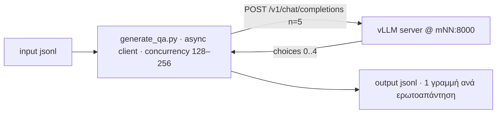

# MITOS-QA — Παραγωγή synthetic ερωτήσεων και απαντήσεων

Το παρόν περιγράφει το σύστημα δημιουργίας **synthetic ερωτήσεων–απαντήσεων** από το `data/merged_unfiltered_dataset.jsonl`. Ο vLLM server τρέχει σηκωμένος σε ένα compute node του ARIS (OpenAI-compatible API στη θύρα 8000), με στόχο **Bulk QA** και **128–256 παράλληλα requests**. Ζητούμενο: η παραγωγή να γίνεται με **μέγιστο throughput**, αξιοποιώντας πλήρως τις δυνατότητες του vLLM (continuous batching, parallel sampling).

## 1. Σκοπός

Για κάθε γραμμή του `data/merged_unfiltered_dataset.jsonl`:

- παράγονται **τουλάχιστον 5 μοναδικά** ζεύγη ερώτησης–απάντησης, βασισμένα **αποκλειστικά** στο κείμενο της γραμμής (τίτλος, περιγραφή, προϋποθέσεις) — χωρίς διπλότυπα·
- κάθε ζεύγος αποθηκεύεται ως **μία γραμμή JSONL** στο αρχείο εξόδου (σχήμα §5)·
- η ροή δεν «κολλάει» ποτέ: μόλις ολοκληρώνεται μια γραμμή, ξεκινά αμέσως η επόμενη (βλ. §6).

## 2. Αρχιτεκτονική



- **vLLM server** — σηκωμένος σε compute node (`mNN`), OpenAI-compatible API στη θύρα 8000· για bulk παραγωγή ξεκινά με `--dtype float32` (εντολή εκκίνησης: §6.2). Το πρώτο startup θέλει λεπτά (AOT compile — περισσότερο με TP=8).
- **Client (QA generator)** — async script στο login node, όπου το `http://<node>:8000` είναι απευθείας προσβάσιμο. Από το PC χρειάζεται πρώτα `bash VLLM/TOOLS/forward_port.sh` και μετά `http://localhost:8000`.
- **Εντοπισμός node** — δίνεται ως παράμετρος (π.χ. `--node m42`) ή εντοπίζεται αυτόματα από το RUNNING job (ίδια λογική με το `VLLM/TOOLS/forward_port.sh`):

  ```bash
  NODE=$(squeue -u $USER -n vllm_cpu -h -t RUNNING -o "%N" | head -n 1)
  ```

- **Έλεγχος ετοιμότητας** πριν ξεκινήσει ο client:

  ```bash
  curl -s http://$NODE:8000/v1/models
  ```

  Χρησιμοποίησε ως `model` το `id` που επιστρέφεται — αποφεύγεται 404 από διαφορετικό `WORKDIR`. Αν το curl δεν απαντήσει ακόμη, ο server φορτώνει.

## 3. Είσοδος — `data/merged_unfiltered_dataset.jsonl`

Κάθε γραμμή έχει σχήμα:
```jsonl
{
    "source":"οτι εχει η γραμμή",
    "doc_id": "οτι εχει η γραμμή",
    "source_url": "οτι εχει η γραμμή",
    "title_el": "οτι εχει η γραμμή",
    "simple_description": "οτι εχει η γραμμή",
    "requirements": "οτι εχει η γραμμή"
}
```

Τα πεδία της γραμμής περνούν **αυτούσια** στην έξοδο.

## 4. Ροή παραγωγής

Για κάθε γραμμή εισόδου:

1. **Prompt** — χτίσε ένα μήνυμα `user` που περιλαμβάνει τον τίτλο, την περιγραφή και τις προϋποθέσεις της γραμμής (§4.1).
2. **Αποστολή** — `POST /v1/chat/completions` με:
   - `n: 5` → το prompt επεξεργάζεται **μία φορά** και παράγονται 5 ανεξάρτητα δείγματα (parallel sampling) — γρηγορότερο από 5 ξεχωριστά requests (1 prefill αντί 5)·
   - `temperature: 0.8–1.0`, `top_p: 0.95`, `max_tokens: ~1024`, `stream: false`, σταθερό `seed` ανά (doc, δείγμα) για αναπαραγωγιμότητα·
   - **ποτέ** `temperature = 0` με `n > 1` — όλα τα δείγματα θα είναι ταυτόσημα.
3. **Parsing** — από κάθε `choices[i].message.content` εξάγονται «Ερώτηση: …» και «Απάντηση: …».
4. **Dedup** — κανονικοποίηση (πεζά, χωρίς τόνους/στίξη/διπλά κενά) + έλεγχος ομοιότητας (π.χ. `difflib.SequenceMatcher(...).ratio() ≥ 0.8`)· κρατούνται μόνο τα μοναδικά.
5. **Συμπλήρωση** — αν απομείνουν <5 μοναδικά (διπλότυπα ή άκυρες απαντήσεις), στέλνονται επιπλέον requests για τη γραμμή (νέο seed), μέχρι να συμπληρωθούν.
6. **Εγγραφή** — τη «Πηγή» την προσθέτει **ο client** (όχι το μοντέλο):
   - αφαίρεσε τυχόν γραμμή «Πηγή: …» από την απάντηση του μοντέλου (να μη βγει διπλή)·
   - πρόσθεσε στο τέλος του `answer`, χωρισμένη με κενή γραμμή: `Πηγή: [{source}]({source_url})` (κείμενο συνδέσμου = `source`, URL = `source_url`) — π.χ. `Πηγή: [mitos.gov.gr](https://id.mitos.gov.gr/493836)`· παράλειψέ το αν λείπει το `source_url`·
   - γράψε αμέσως το ζεύγος στην έξοδο (append + flush)· η επόμενη γραμμή εισόδου ξεκινά χωρίς αναμονή.

### 4.1 Πρότυπο prompt (παράδειγμα)

Ο client στέλνει ένα μήνυμα `user` με οδηγία + τίτλο + περιγραφή + προϋποθέσεις. Παράδειγμα (γραμμή `doc_id=493836`), μαζί με την αναμενόμενη απάντηση του μοντέλου:

````
USER
Από τα παρακάτω στοιχεία (τίτλο, περιγραφή, προϋποθέσεις) δημιούργησε μια σαφή, ρεαλιστική ερώτηση και μια απάντηση για αυτήν. Να βασιστείς αποκλειστικά σε αυτά, χωρίς εξωτερικές γνώσεις· απάντησε στα ελληνικά.
Η απάντησή σου να έχει αποκλειστικά τη μορφή «Ερώτηση: …» / «Απάντηση: …» — σύντομη, αυτοτελής, δομημένη σε Markdown (σαν καταχώριση FAQ). Μη συμπεριλάβεις τίποτε άλλο (ούτε σχόλια, ούτε «Πηγή» ή συνδέσμους).
Τίτλος: Πρόγραμμα κατάρτισης ανέργων δικαιούχων ΕΕΕ και επιχορήγησης επιχειρήσεων για την απασχόληση αυτών. 
Περιγραφή: H διαδικασία αφορά στην αναβάθμιση των δεξιοτήτων ή/και η επανακατάρτιση της ομάδας – στόχου σε τομείς υψηλής ζήτησης όπως τα επαγγέλματα γραφείου και οι πωλήσεις και παράλληλα η ένταξη στην απασχόληση των ωφελούμενων. Συγκεκριμένα, το έργο περιλαμβάνει κατάρτιση και πιστοποίηση των αποκτηθεισών γνώσεων και δεξιοτήτων καθώς και πρόγραμμα δωδεκάμηνης (12) επιχορηγούμενης από τη Δ.ΥΠ.Α. απασχόλησης για την απόκτηση επαγγελματικής εμπειρίας.
Θεσμικός φορέας: ΥΠΟΥΡΓΕΙΟ ΚΟΙΝΩΝΙΚΗΣ ΣΥΝΟΧΗΣ ΚΑΙ ΟΙΚΟΓΕΝΕΙΑΣ
Κόστος: Παρέχεται χωρίς κόστος
Αριθμός δικαιολογητικών: 4
Σημεία εξυπηρέτησης: Παρέχεται μόνο ψηφιακά
Ψηφιακά σημεία παροχής: Ενιαία Ψηφιακή Πύλη δημόσιας διοίκησης (ΕΨΠ - gov.gr)

Προϋποθέσεις (requirements):
- Δικαιούχοι του Προγράμματος Απασχόλησης είναι ιδιωτικές επιχειρήσεις και γενικά εργοδότες του ιδιωτικού τομέα που ασκούν τακτική οικονομική δραστηριότητα και δραστηριοποιούνται σε όλες τις
περιφέρειες της Χώρας.
- Να μην δραστηριοποιείται σε μη επιλέξιμους τομείς και να συμμορφώνεται με τους ευρωπαϊκούς Κανονισμούς (ΕΕ) 2023/2831 (de minimis) ή (ΕΕ) 651/2014 όπως έχει τροποποιηθεί με τον Κανονισμό (ΕΕ) 2023/1315 (ΓΑΚ), ανάλογα με το καθεστώς ενίσχυσης που επιλέγει η επιχείρηση.
- Απαραίτητη προϋπόθεση για την υποβολή της ηλεκτρονικής αίτησης υπαγωγής είναι η ενδιαφερόμενη επιχείρηση (τόσο για την έδρα όσο και για τα υποκαταστήματα) να είναι εγγεγραμμένος χρήστης στο πληροφοριακό σύστημα (portal) της Δ.ΥΠ.Α. και να διαθέτει κωδικούς πρόσβασης σε αυτό (Ονομασία Χρήστη και Συνθηματικό). Ο δικαιούχος εγγράφεται στις ηλεκτρονικές υπηρεσίες της Δ.ΥΠ.Α. με χρήση κωδικών TAXISnet (εκτός ατομικής επιχείρησης ήδη εγγεγραμμένων φυσικών προσώπων και υποκαταστημάτων επιχειρήσεων οποιασδήποτε νομικής μορφής).
- Επιχειρήσεις που είναι ήδη εγγεγραμμένοι χρήστες στο Ο.Π.Σ. Δ.ΥΠ.Α. πρέπει να επικοινωνήσουν (τηλεφωνικά ή/και μέσω ηλεκτρονικού ταχυδρομείου) με τις αρμόδιες Υπηρεσίες της Δ.ΥΠ.Α. πριν την
υποβολή της αίτησης, εφόσον απαιτείται, για επικαιροποίηση των στοιχείων τους. Η επικαιροποίηση των στοιχείων (όπως αλλαγή έδρας), γίνεται με υπεύθυνη δήλωση του εργοδότη, η οποία αποστέλλεται είτε μέσω του Gov.gr, είτε μέσω ηλεκτρονικού ταχυδρομείου (e-mail) στο αρμόδιο ΚΠΑ2.
Στην περίπτωση αποστολής e-mail, για τη διασφάλιση της εγκυρότητας των υποβαλλόμενων δικαιολογητικών ή αιτημάτων, οι συναλλασσόμενοι πρέπει να αποστέλλουν μαζί και επικυρωμένη
υπεύθυνη δήλωση ή υπεύθυνη δήλωση που εκδίδουν από την εθνική ψηφιακή πύλη gov.gr.
Στην υπεύθυνη δήλωση δηλώνεται ότι διαβιβάζεται το συγκεκριμένο αίτημα ή/και τα συγκεκριμένα δικαιολογητικά.

ASSISTANT
Ερώτηση: Ποια είναι η διαδικασία εγγραφής και πρόσβασης των επιχειρήσεων στο σύστημα της Δ.ΥΠ.Α. για το πρόγραμμα απασχόλησης;

Απάντηση:
```markdown
# Διαδικασία Εγγραφής και Πρόσβασης Επιχειρήσεων στη Δ.ΥΠ.Α.

Η διαδικασία εγγραφής και πρόσβασης περιλαμβάνει:

1. **Απαιτούμενες Προϋποθέσεις:**
   - Εγγραφή στο πληροφοριακό σύστημα (portal) της Δ.ΥΠ.Α. για την έδρα και τα υποκαταστήματα
   - Διαθέσιμοι κωδικοί πρόσβασης (Ονομασία Χρήστη και Συνθηματικό)

2. **Τρόποι Εγγραφής:**
   - Χρήση κωδικών TAXISnet για ατομική επιχείρηση (εκτός από ήδη εγγεγραμμένα φυσικά πρόσωπα και υποκαταστήματα)
   - Για νέα εγγραφή στις ηλεκτρονικές υπηρεσίες της Δ.ΥΠ.Α.

3. **Σημαντικές Επισημάνσεις:**
   - Επιχειρήσεις με υπάρχοντες κωδικούς στο Ο.Π.Σ. Δ.ΥΠ.Α. χρειάζονται επικαιροποίηση στοιχείων πριν την υποβολή αίτησης
   - Η επικαιροποίηση γίνεται με υπεύθυνη δήλωση μέσω gov.gr ή email στο αρμόδιο ΚΠΑ2

Η διαδικασία είναι υποχρεωτική για την υποβολή ηλεκτρονικής αίτησης υπαγωγής στο πρόγραμμα.
```
````

> **Σημείωση:** το prompt (§4.1) ζητά ρητά μόνο «Ερώτηση: …» / «Απάντηση: …», χωρίς «Πηγή» ή συνδέσμους — τη «Πηγή» την προσθέτει **ο client** κατά την εγγραφή, από τα πεδία `source` + `source_url` της γραμμής (§4, βήμα 6).

## 5. Έξοδος — μία γραμμή JSONL ανά ερωτοαπάντηση

Για κάθε γραμμή εισόδου παράγονται **τουλάχιστον 5 εγγραφές** (χωρίς διπλότυπα). Το αρχείο γράφεται **append-only**, με flush ανά εγγραφή — ασφαλές σε διακοπή (βλ. §7).

Σχήμα γραμμής εξόδου:
```jsonl
{
    "source":"οτι εχει η γραμμή",
    "doc_id": "οτι εχει η γραμμή",
    "source_url": "οτι εχει η γραμμή",
    "title_el": "οτι εχει η γραμμή",
    "simple_description": "οτι εχει η γραμμή",
    "requirements": "οτι εχει η γραμμή",
    "question": "Εδώ θα μπει η ερώτηση", "answer": "Εδώ θα μπει η απάντηση"}
```

**Σημείωση:** στο πεδίο `answer` κάθε εγγραφής, στο τέλος, υπάρχει η «Πηγή» που προσέθεσε ο client (§4, βήμα 6) — δεν την παράγει το μοντέλο.

## 6. Απόδοση — αξιοποίηση του vLLM στο έπακρο

### 6.1 Το κλειδί: πολλά requests σε πτήση (continuous batching)

Ο vLLM αποδίδει όταν γεμίζει το batch — το throughput κλιμακώνεται με τα ταυτόχρονα requests. Μετρήσεις σε compute nodes («c» = concurrency του client, aggregate tok/s):

| Ρύθμιση server | c=1 | c=32 | c=64 | c=128 | c=256 |
|---|---|---|---|---|---|
| 1 rank, fp32 (20 CPUs) | 1.4 | 35.2 | 47.4 | **49.4** | — |
| TP=8, fp32 (full node) | 4.6 | ≈82 | 106.8 | 114.5 | **128.4** |

- Με **128–256 requests σε πτήση** το κέρδος φτάνει **~35×–90×** σε σχέση με serial requests.
- Οι μετρήσεις είναι με σύντομες απαντήσεις· με μεγαλύτερα QA outputs τα απόλυτα νούμερα πέφτουν, η κλιμάκωση παραμένει. Αναπαραγωγή: `VLLM/TOOLS/bench_scale.sh`, `VLLM/TOOLS/bench_tp.sh`.

### 6.2 Εκκίνηση του server σε Bulk QA mode

```bash
cd VLLM

# Α) Οικονομικό — 1 rank, 20 CPUs: 35–49 tok/s @ concurrency 32–128
VLLM_DTYPE=float32 VLLM_MAX_LEN=32768 VLLM_CPU_KVCACHE_SPACE=16 sbatch run_vllm_cpu.sh

# Β) Μέγιστο throughput — full node, TP=8: έως ~128 tok/s @ concurrency 256
VLLM_TP=8 VLLM_DTYPE=float32 VLLM_MAX_LEN=16384 VLLM_CPU_KVCACHE_SPACE=8 \
    sbatch --cpus-per-task=128 --mem=160G run_vllm_cpu.sh
```

- **Γιατί fp32:** στα AVX2-only compute nodes μόνο το fp32 ενεργοποιεί τα βελτιστοποιημένα oneDNN GEMMs· bf16/fp16 πέφτουν στο torch fallback και το throughput κολλάει.
- Το `VLLM_CPU_KVCACHE_SPACE` είναι **ανά rank** όταν `TP>1` (TP=8: 8 GiB × 8 ranks).
- Περίμενε το `/v1/models` (§2) πριν εκκινήσεις τον client.

### 6.3 Κανόνες του client

- **Concurrency 128–256** ταυτόχρονα requests (αρχική τιμή: **192**)· σε single-rank server δούλεψε στο 32–128.
- **Async παντού:** asyncio + aiohttp με **ένα** connection pool (`aiohttp.TCPConnector(limit=concurrency)`, keep-alive) — όχι νέο session ανά request.
- **Χωρίς streaming** (`stream: false`) — δεν προσθέτει throughput στο bulk.
- **Καμία αδράνεια:** worker pool + `asyncio.Queue`· μόλις ολοκληρώνεται μια γραμμή ξεκινά ακαριαία η επόμενη — ποτέ λιγότερα από ~32 in-flight.
- **`n=5` ανά request** (parallel sampling): 1 prefill + 5 δείγματα (§4).
- **Retries με backoff** για timeouts/5xx/429 (2–3 προσπάθειες), χωρίς να μπλοκάρουν τη ροή.
- **Ζωντανή μέτρηση:** in-flight requests, docs/min, tok/s (από το `usage` κάθε response), σε τακτικό log.
- **KV cache = ο πραγματικός περιορισμός:** κάθε in-flight ακολουθία δεσμεύει ≈256 KiB/token (fp32). Αν στα server logs βλέπεις συχνά `preemptions` ή μεγάλες ουρές: αύξησε `VLLM_CPU_KVCACHE_SPACE`/`--mem` ή χαμήλωσε λίγο τη concurrency· κράτα χώρο και για `concurrency × n` sequences (`--max-num-seqs`).
- Χρήση του **ήδη τρέχοντος server** μέσω HTTP — όχι offline `LLM.generate` (θα φόρτωνε δεύτερο αντίγραφο του μοντέλου στη μνήμη).

## 7. Ανθεκτικότητα και συνέχεια

- **Validation:** έγκυρο ζεύγος = περιέχει «Ερώτηση:» και «Απάντηση:» και ξεπερνά ένα ελάχιστο μήκος· αλλιώς πάει για συμπλήρωση (top-up).
- **Resume:** στην εκκίνηση διάβασε το αρχείο εξόδου· γραμμή εισόδου με ≥5 έγκυρα ζεύγη παραλείπεται, αλλιώς συμπληρώνεται.
- **Seeds:** `seed = hash(doc_id, i)` → ίδια δείγματα σε επανάληψη.
- **Αποτυχίες:** μετά από ~3 αποτυχημένες προσπάθειες ανά request — ή αν μια γραμμή δεν φτάνει τα 5 μοναδικά μετά από ~10 δείγματα — καταγράφεται σε `failures.jsonl` (`doc_id` + αιτία) και η ροή συνεχίζει· στο τέλος ξανατρέχεις μόνο τις αποτυχίες.

## 8. Υλοποίηση (πρόταση)

- Script `generate_qa.py` στο root του repo· Python 3.12 από το venv `VLLM/vllm_cpu_env` (περιέχει `aiohttp` — εξάρτηση του vLLM).
- Ενδεικτική διεπαφή:

  ```bash
  python generate_qa.py \
      --input data/merged_unfiltered_dataset.jsonl \
      --output data/synthetic_qa.jsonl \
      --node m42 \
      --concurrency 192 \
      --samples 5 \
      --max-tokens 1024
  ```

- `--node m42` ή `--base-url http://m42:8000` — default: auto-detect από το RUNNING job·
- `--concurrency 192` (εύρος 128–256)· `--samples 5`· `--max-tokens 1024`· προαιρετικό `--limit N` για δοκιμαστικό τρέξιμο.
- Append-only writer + resume (§7), progress logs σε stdout.

## 9. Παγίδες

- **Model id:** πάρε το από `GET /v1/models`· λάθος path/`WORKDIR` → 404.
- **Startup:** «Connection refused» = ο server φορτώνει ακόμη (AOT compile· με TP=8 ≈6–13 λεπτά την πρώτη φορά — μετά το AOT cache επιταχύνει).
- **Node αλλάζει** σε κάθε νέο SLURM job → ξανά έλεγχος `squeue` / `forward_port.sh`.
- **Μην τρέχεις serial:** κάτω από ~32 παράλληλα requests το throughput καταρρέει (1.4 vs 49 tok/s).
- Ο client τρέχει από το login node· από το PC απαιτείται το `forward_port.sh`.

## 10. Συμπεράσματα από το πλήρες run (job 171908)

Πλήρες run παραγωγής (full node, `VLLM_TP=8 VLLM_DTYPE=float32 VLLM_MAX_LEN=16384 VLLM_CPU_KVCACHE_SPACE=8`), στοιχεία από τα `VLLM/OUTPUTS/vllm_cpu_171908.out` / `.err`: **17h31m** λειτουργίας server, **10.553 αιτήματα**, **μηδέν σφάλματα**.

### 10.1 Χρονοδιάγραμμα

| Φάση | Χρόνος | Διάρκεια |
|---|---|---|
| Εκκίνηση (job start → ready) | 15:42:13 → 15:47:55 | 5m42s |
| Φάση Α (client ενεργός) | 15:48:26 → 04:24:46 | 12,61 h |
| Παύση client (engine εντελώς idle) | 04:24:46 → 07:06:57 | 2,70 h |
| Φάση Β (resume) | 07:06:57 → 09:13:18 | 2,11 h |

Η εκκίνηση αναλύεται σε: φόρτωση βαρών (15,28 GiB safetensors → fp32, 4 shards) **126 s**· AOT compile + profiling/warmup (8 ranks) **~2,5 min**· `init engine` συνολικά **147 s**. KV cache: 262.144 tokens (8 GiB × 8 ranks) = 16× συρροή για 16K context· πρώτα requests ~30 s μετά το ready.

### 10.2 Στατιστικά απόδοσης (από τα server logs)

| Μετρική | Φάση Α | Φάση Β | Σύνολο |
|---|---|---|---|
| Ενεργή διάρκεια | 12,61 h | 2,11 h | 14,72 h |
| Αιτήματα 200 OK | 8.652 | 1.901 | **10.553** |
| Αιτήματα/ώρα | 686 | 903 | 717 |
| Prompt tokens | 4,62 M | 0,63 M | **5,45 M** (516/αίτημα) |
| Generated tokens | 3,63 M | 0,57 M | **4,20 M** (398/αίτημα ≈ 80/δείγμα) |
| Generation tok/s (μέσο/διάμεσο/max) | 79,9 / 81,5 / 192,0 | 75,4 / 77,2 / 144,6 | — |
| Prompt tok/s max | 1.680 | 1.638 | — |
| Running sequences (μέσο/max) | 179 / 960 | 147 / 220 | max 960 |
| Waiting max | 779 | 11 | 779 |
| KV cache χρήση max | 97,7 % | 28,4 % | 97,7 % |
| Prefix cache hit rate | 41,2 % → 76,5 % (max 92,2 %) | 76,5 % → 77,9 % | max 92,2 % |

- **Καμία αστοχία σε 17,5 h:** μηδέν 4xx/5xx, μηδέν preemptions, μηδέν aborts/tracebacks — μόνο 16 αθώα `shm_broadcast` warnings.
- Το KV άγγιξε **97,7 %** μόνο στην «πλημμύρα» εκκίνησης (960 running / 779 waiting, ~16:00)· έκτοτε ουρά 0 και χρήση 25–35 %.

### 10.3 Παραδοθέν έργο (client-side)

- Επεξεργάστηκαν **5.113 από τις 5.114 γραμμές** εισόδου (99,98 %) → **25.323 ζεύγη** στο `data/mitos_qa.jsonl` (4.971 docs × 5 ζεύγη· 142 docs με 1–4)· 143 docs στο `failures.jsonl` (2,8 %, «not enough unique pairs»).
- 10.553 αιτήματα × n=5 ≈ **52.800 δείγματα** → τα ~48 % κρατήθηκαν μετά το dedup → ~**2,06 αιτήματα/doc** (τα υπόλοιπα είναι top-ups με νέο seed).
- Ρυθμός: **~1.450 ζεύγη/h** συνολικά (17,41 h wall) ή ~1.720/h σε ενεργό χρόνο — το dataset ολοκληρώθηκε σε **~15 h ενεργής λειτουργίας** (ελαφρώς καλύτερα από την εκτίμηση ~18 h του Readme).
- Η παύση ήταν ακίνδυνη: στις 07:06 πάρθηκε backup του output (`mitos_qa copy.jsonl`, 22.455 ζεύγη) και το resume πρόσθεσε **527 νέα docs** + top-ups στα εκκρεμή, χωρίς σφάλματα.

### 10.4 Συμπεράσματα

1. **Ο κορεσμός του decode είναι στα ~80 tok/s aggregate** για αυτό το workload (~530-token prompts, ~80-token απαντήσεις): και οι δύο φάσεις έδωσαν σταθερό μέσο 75–80 tok/s (με αιχμές ~150 tok/s) ανεξάρτητα από τη διακύμανση των in-flight requests (μέσο 147–179). Με ουρά 0 και KV κάτω από 35 %, το bottleneck είναι το compute του decode, όχι η μνήμη — περισσότερη concurrency από ~200 δεν αυξάνει throughput, μόνο KV usage.
2. **Latency trade-off (αναμενόμενο για bulk):** στα ~180 ταυτόχρονα sequences κάθε stream αποδίδει ~0,44 tok/s (απάντηση 80 tokens ≈ 3 min), έναντι 4,6 tok/s single-stream (§6.1). Για interactive χρήση παραμένει σωστό το single-stream/bfloat16.
3. **Το prefix caching αποδίδει:** 41 % στην εκκίνηση → σταθερά **77–92 %** — το κοινό τμήμα του prompt (§4.1) πληρώνεται μία φορά· να μείνει ενεργό.
4. **Τα 8 GiB KV/rank αρκούν** μετά την αρχική πλημμύρα (25–35 % χρήση)· το burst των 960 seqs που άγγιξε 97,7 % δείχνει το μόνο σημείο που θέλει προσοχή (throttle του client στην εκκίνηση ή περισσότερο KV αν ξαναγίνει τόσο μεγάλο μπούκωμα).
5. **Αξιοπιστία μεγάλων runs:** 17,5 h χωρίς restart, χωρίς leaks, με ομαλό resume μετά από παύση 2,70 h — το append-only + resume σχήμα (§7) επιβεβαιώθηκε στην πράξη (η Φάση Β ξεκίνησε μετά από `GET /v1/models` και συμπλήρωσε κανονικά).
6. **Το μεγαλύτερο περιθώριο βελτίωσης είναι τα top-ups:** ~52 % των δειγμάτων απορρίπτονται ως διπλότυπα, σχεδόν διπλασιάζοντας τα αιτήματα ανά doc. Επειδή το throughput είναι κορεσμένο, ο χρόνος κλιμακώνεται με τον όγκο των tokens — λιγότερα top-ups (π.χ. μεγαλύτερη ποικιλία δειγμάτων) μειώνουν σχεδόν ανάλογα τη συνολική διάρκεια.
